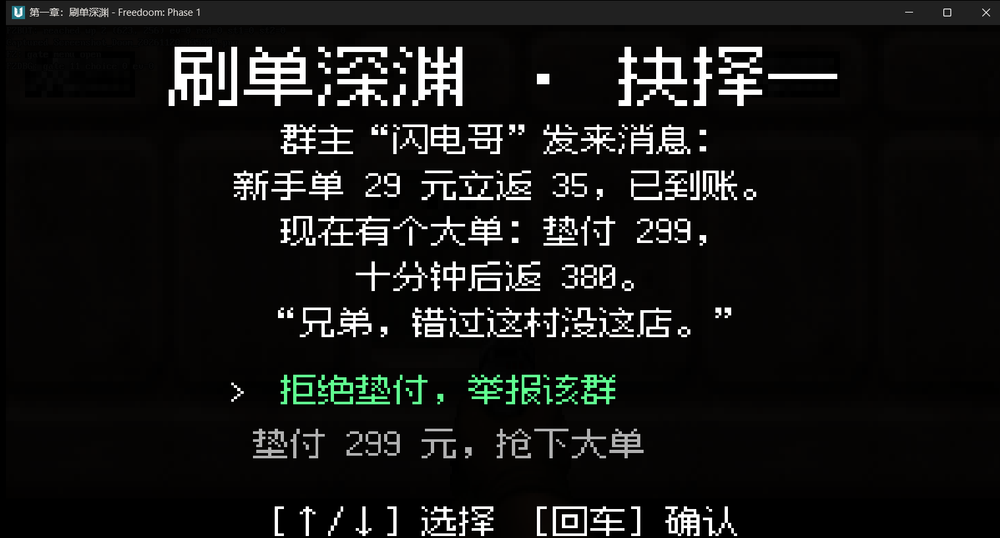
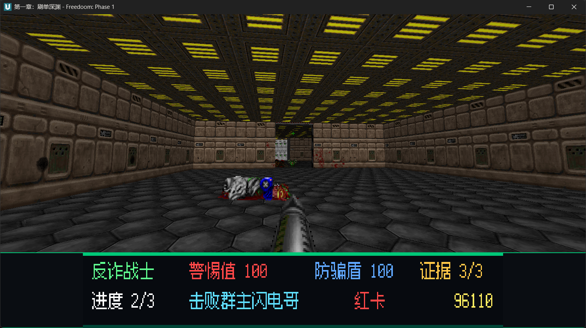
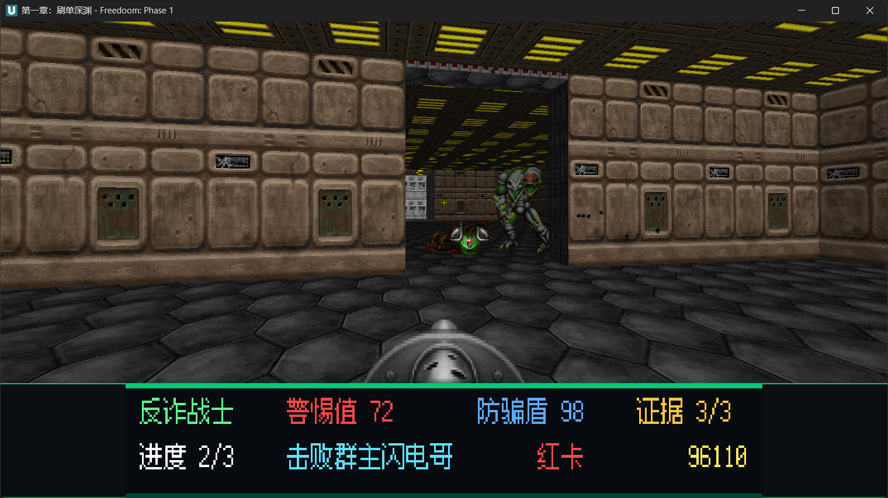

# 反诈战士

基于 Doom 引擎（UZDoom 5.0.3 + Freedoom）的公安反诈宣传游戏。

开源仓库：<https://github.com/Fiagainster/anti-fraud-warrior>（GPL-3.0）
**当前状态：三章演示可玩，已出交付包** —— 刷单深渊 / 装备黑市 / 警服幻影。

## 交付包

```
dist/fanzha-demo-v0.1.zip        ← 发给别人玩这个（37 MB）
dist/fanzha-demo-v0.1/           ← 解压即玩的目录
  run.bat                        ← 双击启动
  README.txt                     ← 玩家说明（操作/流程/许可）
```

包内自带引擎、IWAD、地图、配置与许可文件，**不依赖本仓库**。
打包命令：`python tools\make_dist.py`（会先重生成地图与 PK3）。

## 团队协作（开发入口）

新同学从 **[docs/协作/README.md](docs/协作/README.md)** 开始：

```powershell
python tools\doctor.py                 # 环境自检（缺什么会告诉你）
python tools\fetch_vendor.py status    # 校验引擎/IWAD/字体（大文件不入库）
python tools\build.py                  # 缺地图/字体会自动生成
python tools\fz_ctl.py check           # 编译预检
```

- 角色手册：美术 / 地图 / 程序 / 剧情 / 音频（`docs/协作/角色-*.md`）
- 仓库与分支、资源命名、构建验收、授权与 AI 合规：`docs/协作/`
- 系统结构与"新增一章要动哪些文件"：`docs/架构与扩展.md`

## 本仓库内一键游玩

```powershell
python tools\build.py   # 打包（已预构建，可直接跳过）
run.bat                 # 双击启动
```

`config/uzdoom.cfg` 是**只读模板**（在 git 里）。`run.bat` 首次启动会把它复制成
`build/uzdoom.cfg`，引擎只改写后者——否则每次退出都会把窗口位置、时间戳回写进
仓库，`git status` 永远是脏的。想恢复默认按键/画面设置：删掉 `build/uzdoom.cfg`
再启动。

游戏内：走近闪烁的**数据终端**自动弹出抉择菜单（↑↓ 选择，回车确认），
**集齐 3 件证据 + 答对本章两道抉择**（HUD 右下出现红字「红卡」）后到审判门按 E：
门升起并保持敞开，走进去击败幕后主谋，走到出口（绿色开关墙前的小间）即结算本章。
出口后是标准的关卡结算页（击杀/物品/时间），**按回车进入下一章**。
**ESC 需要按住约 2 秒**才能稳定打开主菜单（UZDoom 的按键重复机制会吞短按，
已实测确认；配置文件里已写入 `Escape=menu_main`）。

## 三章内容

| 章 | 骗术 | 抉择点 | Boss |
|---|---|---|---|
| 第一章：刷单深渊 | 刷单返利 | 垫付 299？共享屏幕？ | 群主"闪电哥" |
| 第二章：装备黑市 | 游戏交易诈骗 | 微信直转？钓鱼链接？ | 黑市商人"暗影" |
| 第三章：警服幻影 | 冒充公检法 | 安全账户？协查 APP？ | 影子会长 |

选错抉择会扣警惕值并引来妖魔伏击，选对得防骗盾 +10 与一道进度。
**红卡需要两个条件同时满足**：证据碎片集齐 3 件（3 个证据箱正好凑满，得全捡），
并且本章两道抉择都答对——只捡箱子不答题，HUD 会显示 `证据 3/3` 但**不发红卡**,
审判门不开，同时弹出提示让你回终端重答。这样反诈题才有否决权，而不是"捡箱子就能过"。
**答错不会卡关**：终端在答错后不退休，冷却 4 秒走开再靠近就重新弹菜单，
代价是掉警惕值 + 伏击；`fz_ctl retry` 场景实测了这条路径（错一次 → 重答 → 开门）。
章节衔接走引擎标准流程：出口 → 结算页 → 回车 → 下一章（第三章结束回标题）。
抉择菜单中**正确选项固定为第一项**（教学演示，单按回车即正确作答）。
这是**演示取舍**：现场讲解时讲解员不必分心找选项。正式投放版应把正确项打散到
A/B 之间，否则玩家会学到"回车就对了"——已列入待办。

## 自动化接管（我自己玩 + 验证用的回路）

```powershell
python tools\fz_ctl.py static        # 纯静态逻辑测试（不启动引擎，WAD+MAPINFO+ZScript 交叉校验）
python tools\fz_ctl.py check         # 只做脚本编译预检（无窗口、无弹窗）
python tools\fz_ctl.py tour          # 第一章全程：走位/证据/两道抉择门
python tools\fz_ctl.py gate          # 只到第一道终端并作答
python tools\fz_ctl.py menu          # 只展示抉择菜单（不作答，拍排版）
python tools\fz_ctl.py esc           # ESC 主菜单开合（长按 2 秒）
python tools\fz_ctl.py chapter FZ02  # 单章全流程（FZ01 / FZ02 / FZ03 任选）
python tools\fz_ctl.py lock          # 反例：全答错但捡满证据 → 审判门必须打不开
python tools\fz_ctl.py retry         # 正例：第一题答错 → 回终端重答 → 照样开门
python tools\fz_ctl.py boss          # Boss 死亡 → 主谋证据 → 进度 3/3 → 出口
python tools\fz_ctl.py full          # 三章马拉松（战斗/过场/换关）
```

组成：
- `tools/fz_ctl.py` —— 编排：构建 → 预检 → 启动 → 驱动 → 截图 → 断言
- `tools/test_game_logic.py` —— 静态测试：解析三张 WAD 的 THINGS/LINEDEFS/SECTORS、
  MAPINFO 换关链、ZScript 源码，不需要引擎就能拦住"终端编号错、门锁死、
  空气墙"这类问题（`fz_ctl static` 转调它）
- `tools/winbot.py` —— 真实键鼠注入（SendInput 扫描码）+ 窗口截图（DPI 感知，
  按 **进程 PID** 锁定本脚本启动的窗口，绝不误操作玩家自己的窗口）
- `tools/testhooks/bot/` —— 引擎内路线机器人（真实物理走位、卡点/实体探针、
  菜单内自动作答 cvar、侧移避障）+ 引擎截图

断言口径（`fz_ctl` 的 `report()`）：每章必须
物件生成 2 终端/3 证据/1 简报 → 起点状态干净（ev/red/st 全 0）→ 两道抉择都弹且
作答 → 走到审判门（wp22，正例要求 ev=3 red=1；反例要求 ev=0 red=0）→ 门开进 Boss
房（wp23）→ 出口生效（越过出口线后关卡结束）。
`lock` 反例不看机器人超时，而看**引擎自己打印的 `Red key needed for this door.`**：
那是门确实锁着的第一手证据（机器人卡住可能只是被怪挡住）。

清理时也只按**可执行文件路径**匹配 `_staging/fztest/uzdoom.exe`，不会像
`taskkill /IM uzdoom.exe` 那样把你正在玩的游戏一起关掉。

预检用 `-errorlog` 的 batchrun 模式：脚本/MAPINFO 编译错误直接打印并退出
（返回码 1337），**不会弹出阻塞式错误窗口**。

最近一次全套结果：`static` **161/161**、`chapter FZ02` **13/13**、`chapter FZ03`
**13/13**、`lock` **16/16**、`retry` **9/9**、`boss` **14/14**、`full` **30/30**
（三章连跑 2 分 16 秒，两次换关 + 第三章结束序列）、`check` PASS。

### 自动化里踩过的坑（别重新踩）

- **终端 ednum 必须查表**：`gen_maps.py` 里 `3920 + (gate_a - 11)` 这种算术会让
  第二章生成 3930/3931（证据箱/主谋证据）、第三章 3940/3941（未注册，被引擎静默
  丢弃）——表现就是"第二关走到头要钥匙但没有""第三关没法验证"。现在用
  `GATE_EDNUM` 显式映射 + 生成期 `check_things()` 断言。
- **换关会继承背包**：自定义令牌随 `ObtainInventory` 带到下一章，导致下一章终端
  自认"已答过"直接关闭、门要么天然开要么永远锁死。已在 `WorldLoaded` 里
  `ClearChapterState()` 清零（读档不触发，对存档安全）。
- **合成控制台按键进不去**：`~`/Esc 的 SendInput 事件在这里到不了 SDL raw input，
  所以测试不依赖 `kill monsters`/`god`，改用引擎内 cvar 接缝。
- **带怪跑图的三个必踩点**：弹药会打光（`fz_bot_ammo` 补弹）、怪物会把机器人顶出
  凹室口（卡三次同点自动回退到洞口重进）、贴脸伤害能一 tic 打死（`fz_bot_god`
  续无敌）。这三条只在 `full` 这种连续带怪场景才会同时触发。


## 截图

| 标题页 | 抉择菜单 |
|---|---|
|  |  |

| 竞技场与 HUD | Boss 战 |
|---|---|
|  |  |

## 目录

| 目录 | 用途 |
|---|---|
| `game/` | PK3 工程：ZScript、UDMF 地图、字体、图形（含 `sprites/`、`sounds/`）、语言表 |
| `config/` | 配置**模板**（绑定/分辨率/语言），勿手写精简版；引擎改写的是 `build/uzdoom.cfg` |
| `assets_src/` | 美术/音频/手工地图**源文件**（LFS），含 CREDITS 登记 |
| `tools/` | 地图/字体生成、构建、打包、测试、环境自检 |
| `tools/testhooks/` | 自动化测试钩子（与正式内容隔离） |
| `vendor/` | UZDoom/Freedoom/字体；只提交 `manifest.json`，用 `fetch_vendor.py` 导入 |
| `source/` | 参考源码：1997 DOOM、UZDoom trunk、Freedoom、字体 |
| `dist/` | 交付包（zip + 解压目录） |
| `docs/` | 方案、剧情设定稿、验收清单、截图 |

## 已踩过的坑（重要留档）

1. **.bat 不能写中文**（cmd 用 GBK 解析，UTF-8 中文破坏解析）。
2. **模糊根因**：Windows 125% DPI 全屏被 DWM 拉伸 + 默认纹理过滤。
   对策：窗口模式 + `gl_texture_filter 0`；截图工具必须声明 DPI 感知。
3. **主菜单是图片补丁**（M_NGAME 等），语言表翻不到 → 中文 PNG 覆盖。
4. **调色板 translation 压暗真彩字体** → HUD 用预着色字体 + CR_UNTRANSLATED。
5. **ZScript 作用域**：EventHandler 默认 play，UiTick 是 ui，跨域赋值 =
   "Expression must be a modifiable value"。ui 侧状态用 `ui` 字段。
6. **顶层自由函数不存在**：函数必须挂在类里（static play 方法）。
7. **struct 赋值/返回未实现** → 用 primitive switch 函数替代 struct 传值。
8. **地图必须打成 PWAD 磁盘文件**（PK3 内散装 `maps/xxx.map` 在 5.0.3 启动即
   Access Violation 读 `0x8`；`maps/xxx.wad` 名字查找也不可靠）。UDMF 本身没问题，
   装进 WAD 的 `TEXTMAP` lump 就行。
9. **WAD 目录条目顺序**：filepos 在前、size 在后，写反 = 加载即崩。
10. **纹理/扁平名必须 NUL 填充**（空格填充 → 查不到 → 棋盘格）。
11. **THINGS 的 type 按有符号 16 位读**：ednum > 32767 变负数，物件被当
    "Unknown type" 丢弃（自定义编号请用 3920-3932 这类 <32768 的值）。
12. **THINGS 的 options 位 16 = 仅多人**：写成 7|16 会让单机下所有物品消失。
13. **`level.CreateActorIterator(0)` 是空迭代器**（源码里 id==0 直接返回 null）；
    要遍历实体请给 TID 或用 `ThinkerIterator.Create('Actor')`。
14. **矩形房间边界只能画一次**：重复调用 rect_walls 会把先前留的门洞重新封死
    （表现为"空气墙"）；所有 gap 必须一次给全。
15. **凹室必须在主房间之外**、与主房间共享边线；扇区空间重叠会毁掉 BSP。
16. **自定义 -config 会清空默认绑定**：引擎先 `C_SetDefaultBindings()` 再
    `UnbindAll()`，配置文件里没写的键全部失效（我们曾因此丢掉 ESC 和 ` 键）。
    正式配置必须包含完整绑定；本作已加 `Escape=menu_main`、`` `=toggleconsole ``。
17. **ESC 要长按约 2 秒**（短按被按键重复机制吞掉）。
18. **截图/按键必须按 PID 锁定自己启动的窗口**：否则会抓到玩家自己的
    uzdoom 窗口，把按键打进玩家游戏里。
19. **`-logfile` 偶发不落盘**；自动化以引擎内截图 + stdout 重定向为准。
20. **门的三个坑**：special 26/27/28 是蓝/黄/红 **DR**（会自动关上），
    31/32/33 才是对应的 **D1**（开一次常开）；门面图形必须放在 sidedef 的
    **upper** 纹理（放 middle 会透明，看起来像空气墙）；双面门扇线**不能**
    带 ML_BLOCKING(1)，否则门开了也永远走不过去。
21. **Vulkan 管线缓存损坏**（强杀进程残留）→ 随机 Access Violation；
    删除 `%LOCALAPPDATA%\doom\uzdoom\vulkanpipelinecache` 即愈。
22. **`build.py` 曾只打包 `zscript/fonts/graphics`**，`sprites/`、`sounds/` 被
    默默漏掉——美术把 PNG 放进 `game/sprites/` 却看不见效果，且没有任何报错。
    已修（现在五个目录都打）。加新资源目录时记得同步这份清单。

## 许可

- 本仓库代码与自制内容：**GPL-3.0**（见 [LICENSE](LICENSE)）
- 第三方组件（UZDoom / Freedoom / Fusion Pixel）许可见交付包 `LICENSES/`
  与 [docs/协作/素材授权与AI合规.md](docs/协作/素材授权与AI合规.md)

## 已知行为（不是崩溃）

- 标题页停留数秒后会播放 Freedoom 自带的旧格式 demo；旧格式录像会作用在
  当前起始地图上，看起来像"角色自己在打"。按任意键回到标题即可。后续计划
  用 TITLEMAP 或自录 DEMO 替换（见 docs/开发日志）。
- 单集演示：标题按回车后只有一个章节，引擎会自动跳过章节选择，直接到难度菜单。

## 已知待办

- [x] 敌人 / 武器 sprite —— 6 套骨架各 13 帧、2 把武器 9 帧已全部自研
      （锚点规则见 `docs/角色美术设计.md` §2.1）
- [x] 三个流程必经物件（终端 / 证据箱 / 主谋证据）—— 占位图已落地并接线，
      等正式美术按同名覆盖（步骤见 `docs/协作/角色-美术.md`）
- [ ] 音效仍是 Freedoom 原版（`game/sounds/` 空）——**下一步就做这个**，见 `docs/下一步.md`
- [ ] 音乐仍是 IWAD 别名（`Music = "$MUSIC_E1M1"`），见 `docs/下一步.md` §3
- [ ] 弹药 / 护甲 / 血包仍借 Freedoom 图（`CLIP` `SHEL` `ARM1` `MEDI` `STIM`）
- [ ] 三章地图差异化（目前共用同一套房间布局，仅换材质与敌人）；
      走 `gen_maps.py` 参数化，不换手工地图（理由见 `docs/协作/角色-地图.md`）
- [ ] 抉择正确项轮换（当前固定 A，演示优先；正式版需打散）
- [ ] 抉择菜单的鼠标点击（当前键盘 ↑↓/回车）
- [ ] 章节结算页的过场节奏（背景图已生成 FZBKGRD1-3）
- [ ] 选项子菜单的个别英文残留（引擎语言表补翻）
- [ ] 机器人"被怪堵住"导致的 `full` 偶发卡死（单跑 `chapter` 正常）

**配音不做**：UZDoom 没有对话系统，叙事已经由 banner 与抉择菜单讲清楚，
加配音是负收益。理由写在 `docs/下一步.md` §5。

## 下一步

按玩家感知强度排，详细口径见 **[docs/下一步.md](docs/下一步.md)**：

1. **音效**（P1）：`game/sounds/` 现在是空的，整局听觉全靠 Freedoom。
   第一批只要 10 个，先补证据拾取 / 终端激活 / 审判门 / 两把枪 / 出口开关。
2. **音乐**（P2）：3 首关卡曲 + 菜单曲，OGG Vorbis q4、-16 LUFS、带循环标签。
3. **剩下的 5 个道具图**（P3）：弹夹 / 霰弹 / 防骗盾 / 警惕值 / 简报，不阻塞试玩。
4. 用交付包做一轮真实玩家试玩（重点：抉择文案是否好读、难度曲线）。
5. 三章地图差异化：`gen_maps.py` 参数化，不上 UDB。
