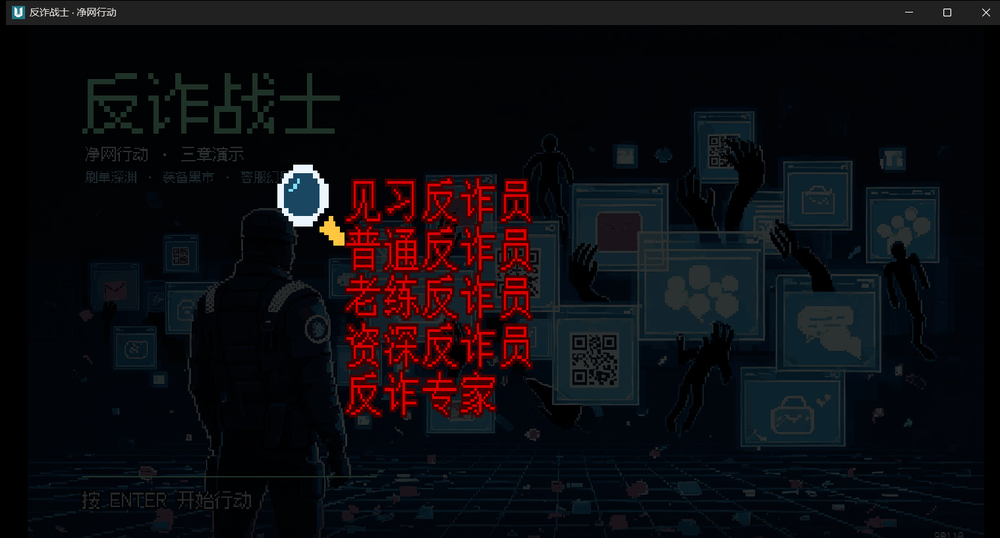

# 开发日志 2026-11-23

## 一句话结论

五首配乐落地：标题 + 三章 + Boss，全部 OGG q5 / 44.1 kHz 立体声 / −16 LUFS /
真峰值 ≤ −1.5 dBFS / **采样级循环点**，接在 `MAPINFO` 与 `gameinfo.titleMusic` 上。

做法不是"让 AI 生成一首歌"，而是**写乐谱 → 用本地音源渲染 → 自己做循环、响度和封装**。
旋律、和声、编排都是这次原创的，没有用任何第三方采样或现成曲子的旋律。

到这一步，声音里最刺耳的穿帮只剩一处：敌人还是原版怪叫。下一轮配音。

## 1 为什么是这条路

brief（`docs/音频设计.md` §4）早就定了，缺的是"谁写"。三条路里：

- **MIDI** 不行：听感取决于玩家机器上的合成器，和 brief 要求的"确定的调性"冲突；
- **纯程序合成（numpy 振荡器）** 不行：那是电子音，做不出"机房/流水线"的质感；
- **本地 SoundFont 渲染** 可行：乐器是真实采样，谱面完全可控，改一个音符重渲一遍只要几秒，
  而且不引入任何音乐版权问题（音源只在渲染时用，不随包分发）。

所以配乐的一侧是"编曲"，另一侧是"把一个音符级乐谱变成成品 OGG 的工程"，后者才是这次真正花时间的地方。

## 2 三个真问题

### 2.1 逐轨电平不能靠猜

第一版 ch1 用"感觉"给的增益，量出来是这样（插件每次渲染都会报每轨 RMS）：

| 轨 | 初版 gainDb | 实测 RMS | 问题 |
|---|---|---|---|
| 鼓组 | −4 | −24.7 dBFS | 基准 |
| 固定音型 | −3 | −28.1 dBFS | 还行 |
| 锯齿主音 | −12 | −39.7 dBFS | **比鼓低 15 dB，旋律被埋** |
| 失真和弦 | −15 | −46.4 dBFS | **低 21.7 dB** |
| 金属垫 | −17 | −51.5 dBFS | **低 26.9 dB** |

根因是 GM 音源里各乐器的**固有电平**差得离谱（马林巴、铺底、编钟天生就比鼓小十几 dB），
同一个 `gainDb` 不可能让它们平衡。

解法：`calibrate.py` 把每条轨**单独**渲染一遍，量"有声音的时候有多响"
（100 ms 短时 RMS 的 90 分位），再按声部角色（bass/lead/pad/bell…）的目标反推增益。
标定后 ch1 是：鼓 −25.8 / 低音 −25.1 / 主音 −28.3 / 失真和弦 −33.6 / 铺底 −33.6，
主音只比鼓低 2.5 dB，旋律出来了。

### 2.2 循环点必须落在采样上，还会被"音符正好收尾"打穿

循环点写进 OGG 的 Vorbis 注释（`LOOP_START` / `LOOP_END`），单位是**采样**。
引擎侧在 ZMusic 的 `music_libsndfile.cpp` 里解析：**纯数字按采样、带冒号按时间**。
用采样就不会有"时间字符串四舍五入"的误差。

第一轮接缝实测（跳变 vs 全曲相邻样本差 99.9 分位）：

| 曲目 | 处理前 |
|---|---|
| title | −13.2 dB |
| ch1 | −7.1 dB |
| ch2 | −20.5 dB |
| **ch3** | **+6.4 dB** |
| boss | −11.5 dB |

ch3 的 +6.4 dB 意味着循环点上的跳变**比全曲最大的采样跳变还大**——那是"咔"。
原因是音符正好在循环点收尾：音源在几毫秒内把声音切断，循环回开头时电平从有到无。

三步修法：

1. 渲染时多渲 5 秒尾音，把循环点之后的尾音**折回**循环点；
2. 如果还有硬边，把循环终点**提前 30 ms**，用等功率交叉淡化让"终点前那 30 ms"从循环点接上，
   接缝两侧就成了相邻采样；
3. 接受循环长度比小节线短 30 ms（人耳听不出，但换来了无缝）。

处理后全部 ≤ −13.8 dB（ch2 本来 −20.5 dB，没动）。

### 2.3 带前视的限幅会把循环点错位

第一版用 ffmpeg 的 `alimiter` 做峰值控制。结果：OGG 开头一小段是纯静音、
循环点和波形对不上，接缝的"咔"始终消不掉。

前视（lookahead）类处理器天然会平移时间轴，而循环素材对"采样对齐"是零容忍的。

改法：自己写离线限幅器——取未来 5 ms 的最小可用增益（非因果，离线可以"看未来"）、
释放阶段一阶平滑、**不做任何时间平移**，最后按 ceiling 兜底裁剪。
顺带修了一个自己的 bug：一阶平滑如果从 0 起步，会把开头几毫秒压掉 69.8 dB（等于吃掉第一个音头），
必须用 `zi` 把初值设成"第一个采样就到位"。

教训写在这里：**任何带 lookahead 的处理器，在循环素材上都要验采样对齐**，不能只看响度达标。

## 3 接线

`game/music/` 放五个 OGG（pk3 从 1.77 MB 涨到 8.35 MB），`game/mapinfo/MAPINFO` 改四处：

```
gameinfo { ... titleMusic = "music/title.ogg" }
map FZ01 "…" { … Music = "music/ch1.ogg" }
map FZ02 "…" { … Music = "music/ch2.ogg" }
map FZ03 "…" { … Music = "music/ch3.ogg" }
```

为什么 `Music` 写完整路径就能找到 pk3 里的文件（查过源码，不是猜）：

```
S_ChangeMusic -> OpenMusic -> FindMusic -> fileSystem.CheckNumForFullName(musicname)
                                         -> fileSystem.CheckNumForName(musicname, ns_music)
```

`CheckNumForFullName` 认的就是 `music/ch1.ogg` 这种路径。标题画面没有 `Music` 字段，
走 `gameinfo` 的 `titleMusic`（`gamedata/gi.cpp` 的 `GAMEINFOKEY_MUSIC(titleMusic, titleOrder, "titleMusic")`，
`d_main.cpp` 在进标题时用它起播）。

`boss.ogg` 暂时没有宿主：三章里还没有 Boss 关。等 Boss 房独立成图，在那张图的 `MAPINFO`
写 `Music = "music/boss.ogg"` 就行，音频不用重做。

## 4 验证

| 项 | 命令 | 结果 |
|---|---|---|
| 脚本/MAPINFO 编译 | `fz_ctl.py check` | PASS |
| 静态交叉检查 | `fz_ctl.py static` | 192/192 |
| 第一章全程 | `fz_ctl.py chapter FZ01` | 13/13（含进入 FZ02） |
| pk3 内容 | `build.py` + 列 zip 条目 | `music/{title,ch1,ch2,ch3,boss}.ogg` 路径正确 |

**注意**：`fz_ctl` 的所有场景都带 `-nosound`，而 `S_ChangeMusic` 在关声音时直接返回——
所以自动化**验不了音乐**。音乐要单独带声音起一次引擎：

```powershell
uzdoom.exe -iwad freedoom1.wad -stdout -file <maps> -file build\fanzha-demo.pk3 +map FZ01
```

判据用的是**对照实验**，不是"没报错应该就没事"：

- 真路径 `music/ch1.ogg`：日志里没有 `Music … not found`；
- 故意改成 `music/nope.ogg`：日志立刻打印 `Music "music/nope.ogg" not found`。

有对照，才能说"没报错 = 真加载到了"。

还差一项只有耳朵能验：**循环接缝连播 3 遍听不出接缝**。试听片段（每首循环点前后各 8 秒）
在配乐工作区 `D:\Project\音乐美术生成\music\out\loopseam\`。

## 5 交付物

| 位置 | 内容 |
|---|---|
| `game/music/*.ogg` | 五首成品（q5、−16 LUFS、带循环标签） |
| `assets_src/audio/music/*.json` | 乐谱源（音符级）+ `manifest.json`（循环点/分轨） |
| `assets_src/audio/music/README.md` | 乐谱格式与重渲流程 |
| `assets_src/CREDITS.md` | 五首歌的 AI 登记（工具/日期/来源/人工修改） |
| `docs/音频设计.md` §4.1 | 落地记录：时长、循环点、实测响度 |
| `MAPINFO` | 三章 `Music` + `gameinfo.titleMusic` |

渲染链在配乐工作区 `D:\Project\音乐美术生成\music\`（`compose.py` → `calibrate.py` →
`build_music.py`），不随游戏仓库走：它依赖 DSH 的 anyaudio 插件与 ffmpeg 静态二进制，
放进来会让游戏仓库多两个重依赖。仓库里留乐谱，任何时候都能重渲。

## 6 已知局限

1. **音色是 GM 近似**：编钟→Tinkle Bell、琵琶→Banjo、唢呐→Shenai。方向对，但不是真采样。
2. **中国元素只是点缀**：每首一处，不做主体——brief 的基调是"机房/流水线/审讯室"。
3. **环境层是程序合成的**（磁带底噪/机房嗡鸣/市集人声/远处警笛），刻意压在乐器之下 25 dB。
4. **没有真人演奏表情**：强弱靠力度与 CC 自动化。
5. **boss 是 16 小节循环**（8 小节核心 + 8 小节变化），比 brief 的 8 小节长一倍——8 小节只有 13.7 秒，重复感太强。
6. **循环依赖 Vorbis 标签**：万一某条解码路径不认标签，会退化成整曲循环（标题曲的前奏/收尾会重复一遍），能用但会听出来。

## 7 下一步（音乐部分）

配音：6 个敌人 × 3 槽位（发现/受伤/死亡）共 18 条。先录刷单业务员的 3 条进 FZ01 实机确认，
再铺开其余 5 个角色。台词、声线、录音规范见 `docs/配音设计.md`。

---

## 8 标题页、轮播页与结局（同日追加）

### 8.1 病根不是"结局"，是三条 Freedoom 的旧内容

开机第一屏、`creditPage` 轮播、通关后的敌人巡礼，原来全是 Freedoom / IWAD 的：

- 标题页是脚本画的网格 + 一块灰板（Blender 徽标没渲出型）；
- 轮播介绍页是 Freedoom 自带的 CREDIT 页；
- 通关后引擎跑默认的 `Inter_Cast`：六只怪站着循环待机/攻击，**按一次键才死一只**，
  不按就一直转，而且背景、名字、音效都是 Freedoom 的。

### 8.2 三条都换掉了

| 位置 | 做法 |
|---|---|
| 标题页 | Ark Seedream 出 2560×1440 插画（雨夜 / 主角背影 / 窝点屏幕墙），脚本裁 16:9、压暗、降 56 色，再用 Fusion Pixel 叠中文 |
| 轮播页 | `gameinfo { creditPage = "FZCRED1"  addcreditPage = "FZCRED2" }`，两页纯脚本绘制（三章 / 反诈提示） |
| 结局 | `defaultendsequence = "FZ_END"` + `intermission FZ_END`：6 个 `cast`（六个敌人各一屏）+ 一张 `image` 终章图 |

关键依据都在源码里：

- 标题页/轮播页：`d_main.cpp` 的 `D_DoAdvanceDemo`，case 2 用 `gameinfo.creditPages[pagecount]`，
  case 0 用 `gameinfo.titlePage`；
- 结局：`g_level.cpp` 在没有 `Next` 时拿 `gameinfo.DefaultEndSequence` 拼 `enDSeQ<索引>`，
  `intermission_parse.cpp` 再按名字查 `intermission` 块；
- 巡礼"一只一屏、按一下死一只"是 `DIntermissionScreenCast` 的 `Responder`：没按键就不进死亡序列。

### 8.3 一个语法坑

`intermission` 块里**不能写分号**。第一版写成 `cast { CastClass = "FZShill"; Background = "FZCASTBG"; }`，
预检直接报 `Script error, "mapinfo" line 25: Expected identifier but got ';' instead.`
这个解析器是"关键字 = 值"逐条读，没有语句分隔符；删掉分号就过了。

### 8.4 验证

- `fz_ctl check` / `static` 192/192 通过；
- 实机截图确认：标题页、两页轮播、巡礼页（背景 + 提示 + 我们的怪）都正常；
- **片尾卡住的坑**：第一版结局块以 `image` 结尾，走到最后一张图后按键没反应、只能 ESC 强退。
  根因在 `intermission.cpp:965`——最后一页对片尾返回 `mEndGame=true`（"must block when ending the game"），
  控制器不会被销毁，也没人调 `D_StartTitle()`。修法是在 `image` 后面加一个 `GotoTitle { }`：
  `NextPage()` 遇到 `TITLE_ID` 会返回 false，流程才真正结束。实测按键即回标题。
- 窗口标题：`game/gameinfo/GAMEINFO` 的 `STARTUPTITLE` 生效（引擎取最后一个 GAMEINFO），
  但该解析器**同样不认分号**，写 `STARTUPTITLE = "…";` 直接开不了机。

### 8.5 还没做

`creditPage` 之后引擎仍会轮播 IWAD 的 DEMO1–3（`D_DoAdvanceDemo` 从 IWAD 找 `DEMO1` 起逐个播）。
要彻底换成自己的回放，得录 3 段 demo 覆盖同名 lump——需要机器人跑几段路线再导出 `.lmp`，留给下一轮。

### 8.6 拾取提示与死亡提示（同日再追加）

Freedoom 的 IWAD 里有个 DEHACKED 的 `[STRINGS]` 段，把 `GOT*`（拾取）、`OB_*`（死亡）、`SKILL_*`（难度名）
全部写成了自己的英文。实测三种覆盖方式都无效：

1. `LANGUAGE` 里写同名键——被 DEHACKED 盖掉；
2. 自己塞一个带 `[STRINGS]` 的 `DEHACKED`——不生效（连纯 ASCII 值都不生效，不是编码问题）；
3. MAPINFO 的 `skill` 块——引擎的 `mapinfo/doomcommon.txt` 比我们的 MAPINFO **更晚**解析，
   我们的块变成"追加"而不是"替换"，结果难度列表变成 10 项、菜单掉进大字体备用页。

所以换了条路：**绕开语言表，直接写在 actor 上**。

- 拾取：每个可拾取类的 `Default` 里加 `Inventory.PickupMessage "…"`；
  弹药/医疗/防骗盾/证据链/两把枪共 12 条。
- 死亡：六个怪各加 `Obituary "…"`（原来只有刷手和影子会长有）。

这两处都不经过 DEHACKED，引擎读到就用。难度名暂时还是英文，要改只能另做一套菜单。

### 8.7 难度菜单重做（同日第三轮）

难度名最后是**重画菜单**解决的，没有改引擎源码。

做法：`game/menudef/menudef.txt`（打包成 pk3 根的 `MENUDEF`）

1. 覆盖 `MainMenu`，只把 `M_NGAME` 的目标从 `PlayerclassMenu` 改成 `FZNewGameMenu`；
2. `FZNewGameMenu` 是 5 个 `TextItem`，动作直接写引擎的 `Startgame`，第四个参数就是 skill 序号：

```
TextItem "见习反诈员", "i", "Startgame", 0
...
TextItem "反诈专家",   "m", "Startgame", 4
```

引擎在 `doommenu.cpp` 的 `NAME_Startgame` 分支里会
`NewGameStartupInfo.Skill = param` → `G_DeferedInitNew` → `M_ClearMenus()`，
所以按下去就按选定难度开局，菜单自己关掉，不需要额外收拾。

踩过的三个坑：

- `Command` 项**只在 OptionMenu 里合法**，ListMenu 里写会报 `Unknown keyword 'Command'`；
  而 OptionMenu 又不认 `Position` / `LineSpacing`。
- `Command` 虽然能 `set skill N; map FZ01` 开局，但那一路不会关菜单，
  会顶着菜单进关——所以没走它。
- `Font "fzfont"` 在 ListMenu 里能解析，可 fzfont 是给 320×200 的 HUD 画的，
  菜单里字会挤在一起；默认菜单字体反而能正常渲染中文，去掉就行。

实测：ESC → 开始行动 → 中文难度菜单 → 选「见习反诈员」→ 地图载入、
菜单消失、简报正常（`chapter FZ01` 13/13、`static` 192/192 通过）。



**光标**：默认用的是 Doom 的骷髅 `M_CURS1`，这轮换成自制的放大镜 `FZSELECT`
（`tools/gen_menu_cursor.py` 画，16×16 放大 2 倍），菜单里写
`Selector "FZSELECT", -32, -6`。只改这一张菜单，主菜单仍是原来的骷髅。

**同日修掉的 bug**：选「资深反诈员 / 反诈专家」进图后**道具和怪物全没了**。
根因在 `tools/gen_maps.py`：地图是 UDMF，物件只写了 `skill1/skill2/skill3`
三个标志，`skill4/skill5` 没写，缺省为 false——第 4、5 档正好对应这两个，
整张图的 thing 全被过滤掉。修法是按 Doom 的原始语义补齐五个标志
（easy→skill1/2，medium→skill3，hard→skill4/5），重生成三张地图后恢复正常。


顺带把结算页四行也换了：`TXT_IMKILLS/IMITEMS/IMSECRETS/IMTIME` → 净化/证据/隐藏点/用时。
这四个键不经过 DEHACKED，`LANGUAGE` 能盖住。

**Autosave 改不了**：它在 `g_game.cpp` 里是硬编码的
`description.Format("Autosave %s", readableTime)`，不查语言表。除非改引擎，否则只能保留英文。

## 9 五个玩家反馈的硬伤（同日第四轮）

一句话：五个症状里有四个是同一类根因——我把"引擎实际看到的世界"当成了
"我在生成器里写的东西"。UDMF 进引擎时会被翻译成另一套编号，地图几何的绕向决定
墙体正反面，而审计脚本只查了我以为该查的三项。

### 9.1 不打 Boss 也能跑出口

第一版闸门写错了，白改一轮：用 `e.ActivatedLine.special == 11` 去拦。
11 是 UDMF 的 `Line_SetIdentification`/`Exit_Normal` 写法，但三张图
`namespace = "ZDoomTranslated"`，装载时要过 `wadsrc/static/xlat/base.txt`，
里面 `11 = USE, Exit_Normal (0)`，`Line.special` 被就地改写成引擎内部号
（`Exit_Normal = 243`、`Exit_Secret = 244`，见 `src/playsim/actionspecials.h`）。
所以拿 11 去比，永不命中。

能改的就一个钩子：`WorldLinePreActivated(WorldEvent e)`，它在 special 真正执行之前
被调用，把 `e.ShouldActivate` 置 false 就等于"这扇门这次没被按"。

```zscript
override void WorldLinePreActivated(WorldEvent e)
{
    let mo = e.Thing;
    if (mo == null || mo.player == null) return;
    let ln = e.ActivatedLine;
    if (ln == null) return;
    if (ln.special != Exit_Normal && ln.special != Exit_Secret) return;
    if (mo.CountInv("FZStage3") > 0) return;   // 已经取下主谋证据
    int total, alive;
    CountBosses(total, alive);                 // ThinkerIterator("BaronOfHell") 能捞到子类
    if (total == 0 || alive == 0) return;
    e.ShouldActivate = false;
    FZMsgItemBase.Push(mo, 906, 220);
    mo.A_StartSound("fz/alarm", CHAN_AUTO);
}
```

`total == 0` 那道保险是必须的：如果哪张图还没放 Boss，闸门不能把整章锁死。
`ThinkerIterator.Create("BaronOfHell")` 会带出子类，而怪物已经换成
`FZChairman replaces BaronOfHell`，所以按类名捞仍然有效。

验证是"正反两遍"：`bosslock FZ03` 期望日志出现 `FZDBG: exit blocked map=FZ03
st3=0 boss=1/1`、机器人 `reached wp 25`（真走到了出口），但关卡**没有**结束——
7/7 断言全过。正例 `boss FZ03` 打死之后按出口正常结算，14/14。

### 9.2 怪物和道具卡在墙里

原来的审计 `[D]` 只查物件中心点是否落在合法扇区，完全不看半径。半径 30 的 Demon
贴着墙放，中心点合法、身体有 10 个单位嵌在墙里，玩家看见的就是"怪卡墙里"。

补了两组检查：

- `[D2]` 物件半径与最近墙体净距（要正确填表：`3002 = Demon(r30)`、
  `3003 = BaronOfHell(r24)`、`3005 = Cacodemon(r31)`…… 我第一次把 3002 当
  ShotgunGuy、3005 当 Demon 填反了，修完立刻多抓出 4 处嵌墙）；
- `[G]` 单面墙绕向，见下节。

实际修掉 5 处：FZ01 一个箱子嵌进柱子 18 单位（1300,400 → 1410,445），
FZ02 两只 Demon 各 10/8 单位，FZ03 两只 Cacodemon 各 1 单位。
现在三章审计 0 条。

### 9.3 第二章的"黑洞"和能透视

这就是单面墙绕反。Doom 的判定很简单：单面墙所在的扇区必须在 `v1→v2` 的
**右手边**。绕反了，引擎会把墙面法线朝向室外，站在室内看到的是这面墙的背面——
没有可画的贴图，于是变成一片纯黑的"洞"，而且因为它不是实心面，视线能穿过去看到
后面的几何。所以"黑洞"和"透视"是同一个 bug 的两个表现，不是两个问题。

根因在 `tools/gen_maps.py` 的 `chamfer_room()`：切角矩形生成时按顺时针拼边，
整个房间的绕向反了。修法是统一成"内侧在右手边"。

顺带记一条常被搞错的做法：两个矩形房间共用一堵墙时，正确画法是**两边各画一条
coincident 的一单面线，方向相反、各自朝内**，而不是画一条双面线。

`[G]` 的自证方法是故意反转一条墙，看审计报不报——报了 5 条才算这检查真在工作。
之前有一轮"黑洞没修好"就是因为审计根本没查这一项，全绿但玩家一眼看出问题。

### 9.4 道具满了就捡不了

证据 `FZEvidence` 是 `maxamount 3` 的上限道具，而来源有四个：三个箱子 + 答对抉择
各发一片。捡满三片之后再去答题，第四片发不进去（引擎不会报错，就是没反应），
箱子里剩下的那片也捡不起来——玩家看到的就是"道具满了捡不了"。

改法是让**来源数和上限对齐**：证据只由三个箱子提供，答对抉择只给防骗盾 +10 与
抉择进度。但这样有个顺序问题：先捡满箱子、后答题的玩家，红卡要在答题那一刻才
发得出来，所以答对分支末尾不再 `Grant()`，改成 `FZEvidenceChain.Recheck(pl)`——
复核一遍发卡条件，不带任何副作用（`Grant(pl, 0, false)`）。

### 9.5 进度写 3/3 是错的

HUD 原来写 `进度 x/3`，但每章只有**两个**抉择终端，分母写 3 只能靠别的东西凑，
于是出现"答两道题就 2/3、拿到红卡、第三个终端根本不存在"。

第三件事是真有的，但不是选择题：打死本章主谋、取走主谋证据。所以拆成两栏：

- HUD：`抉择 x/2`，只数 `FZStage1/FZStage2`；
- 目标文字：`CaseClosed()` 单独判 `FZStage3`，文案写"撂倒主谋、取下证据"。

`fz_hud.zs` 里原来那个 `StageCount()` 返回 0..3 是最容易再踩回去的地方，
注释里已经把"为什么不能这么标"写死在函数上方。

### 9.6 横幅两头被裁字

4:3 画布下，简报横幅一行最多 **17 个全角字**（ASCII 算 0.5）。原来有一条 18 字，
两头各被裁掉半个字。20 条 `MsgText` 全部按这个上限重写，脚本校验"超宽行数: 0"。

### 9.7 交付包陈旧（这轮最该记的教训）

玩家反馈"什么进步都没看出来"，根因不是代码没改，是 `dist/fanzha-demo-v0.1/`
里的 pk3 和地图还是九小时前的。我改完只跑了测试，没跑 `make_dist.py`。

三道防线：

1. 包重出为 `v0.2`，旧的 v0.1 删掉（避免拿错）；
2. 版本号写进窗口标题：`game/gameinfo/GAMEINFO` 的 `STARTUPTITLE`，
   标题栏显示 `第二章：装备黑市 - 反诈战士 · 净网行动 v0.2`；
3. README 顶部写明"标题栏看不到版本号 = 旧包"。

### 9.8 结果

| 项 | 结果 |
|---|---|
| `fz_ctl static` | **196/196**（新增 4 条断言：出口闸门、证据只由箱子给、`Exit_Normal` 常量比对、HUD 分母 = 2） |
| 几何审计 | FZ01/FZ02/FZ03 各 **0 条**（含 `[G]` 绕向、`[D2]` 半径） |
| `chapter FZ02` | 13/13 |
| `bosslock FZ03` | 7/7 |
| `boss FZ03` | 14/14 |

### 9.9 还没解决的：闪屏

只剩这一条。已排除：HUD 的 4:3 边条（24 帧顶边恒 y=622）、FZ03 截图里那个
13×19 黑方块（颜色 `(7,10,15)` 与状态栏底色相同，是 CJK 笔画间隙）、
按住 ESC 反复切菜单（按住期间亮度 54.5→54.8 平稳）。

现在高度怀疑之前的"亮度跳变"是 `winbot.capture`（PrintWindow/BitBlt）抓 GL 窗口
时的全黑帧假象，也就是**测出来的**闪屏而不是玩家看到的闪屏。
要进一步定位，需要复现条件：哪个界面、是否必须动鼠标、整屏还是局部。


