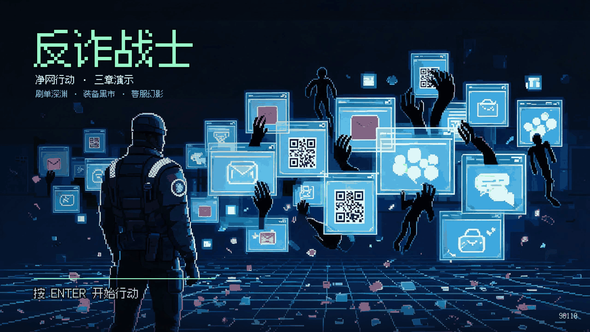
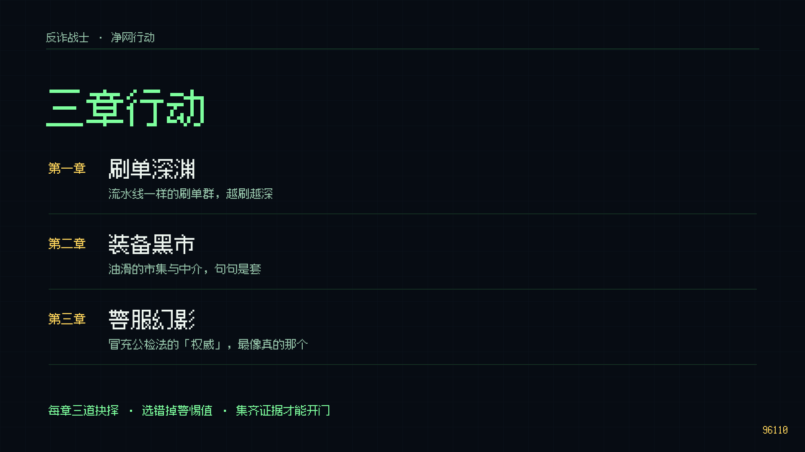

# 标题页、轮播介绍页与片尾

> 一句话：开机第一屏、`creditPage` 轮播、通关后的敌人巡礼与终章图，**全部换成我们自己的**，
> 不再出现 Freedoom 的标题、介绍页和 cast 序列。

---

## 1 现在长什么样

| 位置 | 内容 | 来源 |
|---|---|---|
| 标题页 | 反诈特勤队队员背影，面对一整面悬浮的聊天窗口墙（刷单群/红包/二维码，窗口里伸出手和剪影），脚下是数据网格 | `game/graphics/TITLEPIC.png` |
| 轮播页 1 | 三章行动（刷单深渊 / 装备黑市 / 警服幻影） | `game/graphics/FZCRED1.png` |
| 轮播页 2 | 记住三条（刷单返利、高额回报、96110） | `game/graphics/FZCRED2.png` |
| 通关后 | 六个敌人逐个登场（待机→攻击→倒地），一只一屏 | `intermission FZ_END` 的 6 个 `cast` |
| 巡礼背景 | 深色网格 + 操作提示（按使用键让这只倒下 / ESC 开菜单） | `game/graphics/FZCASTBG.png` |
| 终章图 | 数据空间崩塌：聊天窗口碎成像素、六道妖魔剪影消散、三枚证据碎片聚拢 | `game/graphics/FZENDPIC.png` |

> 首版走的是"现实雨夜街头"，和设定对不上——本作是**潜入骗局网络空间**（见 `docs/剧情.md`），
> 所以 2026-11-23 第二轮换成了数据空间 + 聊天窗口墙，主角也改成特勤队制服。

插画源在 `art/title/cover.jpg`、`art/title/ending.jpg`（AI 生成，登记见 `assets_src/CREDITS.md`）。






---

## 2 MAPINFO 怎么接的

```lisp
gameinfo
{
	titlePage = "TITLEPIC"
	titleTime = 12
	creditPage = "FZCRED1"      // 第一个会清空数组
	addcreditPage = "FZCRED2"   // 之后的要用 add
	pageTime = 8
	advisoryTime = 0
	defaultendsequence = "FZ_END"
}

intermission FZ_END
{
	cast { CastClass = "FZShill"    Background = "FZCASTBG" }
	cast { CastClass = "FZRunner"   Background = "FZCASTBG" }
	cast { CastClass = "FZScalper"  Background = "FZCASTBG" }
	cast { CastClass = "FZBroker"   Background = "FZCASTBG" }
	cast { CastClass = "FZFakeCop"  Background = "FZCASTBG" }
	cast { CastClass = "FZChairman" Background = "FZCASTBG" }
	image { Background = "FZENDPIC" }
	GotoTitle { }
}
```

- `defaultendsequence` 是**没有下一张图时**用的结局：引擎在 `ChangeLevel` 里把它变成
  `enDSeQ<名字索引>`，再按名字查 `intermission` 块（`g_level.cpp` / `intermission_parse.cpp`）。
  所以 FZ03 不用写 `Next`，出口自然进这套结局。
- `cast` 是**一只一屏**：画面里它待机→攻击循环，**按一下键**才播死亡并切下一只；
  六只播完进 `image`，再按键就回标题。不加提示的话，第一次看到的人会以为卡住了——
  所以提示直接烘在 `FZCASTBG` 上。
- `image` 是最后一张，**后面必须跟一个 `GotoTitle { }`**：引擎在片尾状态下走到最后会返回
  `mEndGame=true`，但没有人去结束游戏；少了这一条就会永远停在终章图上（实测卡住，只能 ESC 强退）。

---

## 3 怎么重新生成

```powershell
# 换了插画或改了文案之后
python tools\gen_title.py
python tools\build.py
```

`tools/gen_title.py` 负责：裁 16:9 → 左上/底部压暗 → 用 Fusion Pixel 叠中文 → 降色数保住像素感。
**中文一定不能交给生图模型**，会糊成方块；模型只出插画。

---

## 4 已知限制

1. **`creditPage` 之后仍然会轮播 IWAD 自带的 DEMO1–3**（引擎 `D_DoAdvanceDemo` 从 IWAD 找
   `DEMO1` 起逐个播）。要彻底换成我们的回放，得自己录 3 段 demo 再覆盖同名 lump，属于下一轮。
2. **cast 必须按键推进**，这是引擎机制，不给"自动播完"的开关；我们能做的是把提示写在底图上。
3. 片尾的"按键回标题"已实测通过（临时把一章出口接到结局、按一次键落回标题页验证）。
4. 窗口标题已改：`game/gameinfo/GAMEINFO` 的 `STARTUPTITLE`（该解析器同样**不认分号**，
   写成 `STARTUPTITLE = "…";` 会让引擎开不了机）。
